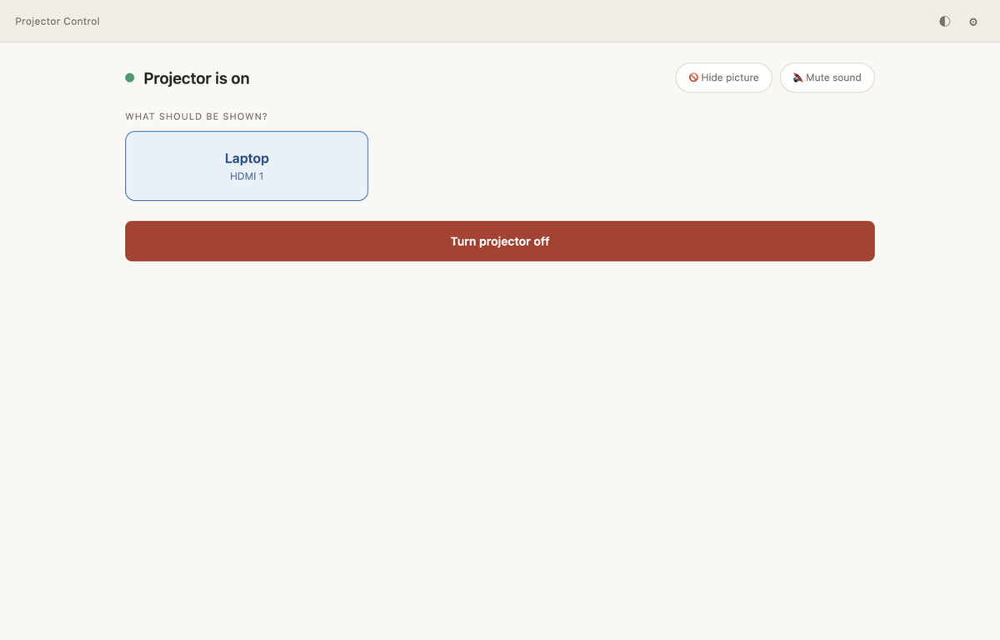
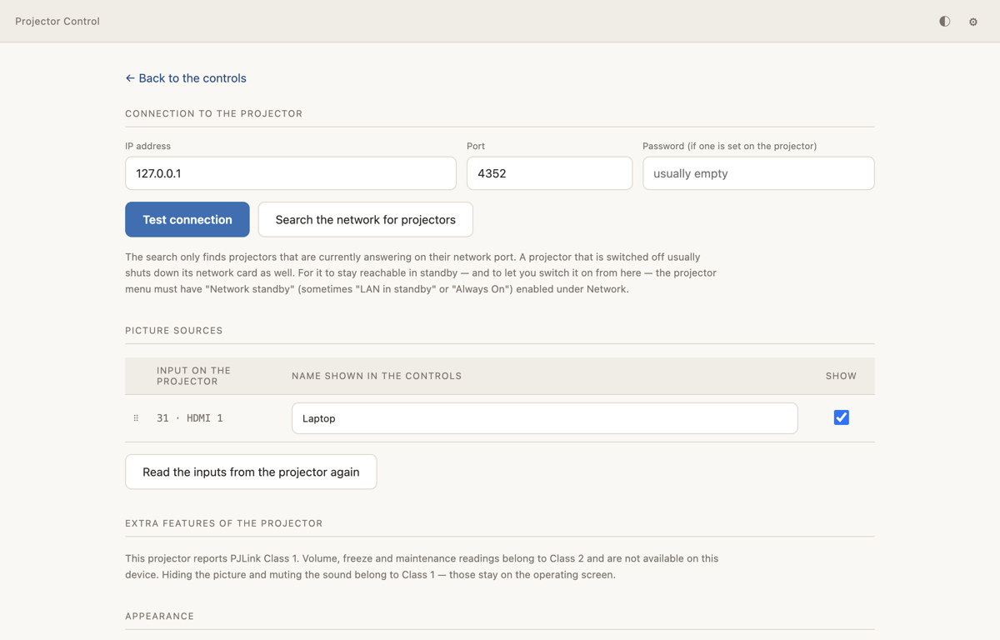

# Beamer Steuerung

A deliberately simple desktop app for switching a network projector on and off,
choosing what it shows, and hiding the picture or muting the sound — built for
a church, where the person at the controls uses it a few times a year and has
no interest in network settings.

It talks to the projector over [PJLink](https://pjlink.jbmia.or.jp/english/),
the open control protocol most network projectors (Epson, Optoma, NEC, Panasonic,
Sony, BenQ, …) understand. The interface is in German and English.



## What it does

**For the person using it,** there is one screen, and it only ever shows what
makes sense right now:

- Projector off: a single button to switch it on.
- Warming up / cooling down: what is happening, and nothing to press.
- Projector on: one tile per picture source with the names you gave them
  ("Laptop", "Camera" instead of "HDMI 1"), *Hide picture* and *Mute sound*
  as separate switches, and a red bar to switch off — with a confirmation.
- No contact: a plain sentence and a retry button, never an error code.

The screen follows the projector, not the other way round: if someone uses the
remote control, the app catches up within about five seconds.

**For whoever sets it up,** everything technical sits behind the gear icon:

- Connection: IP address, port and password, a connection test, and a network
  search.
- Picture sources: read the inputs from the projector, rename, hide and
  reorder them.
- Extra features of PJLink Class 2 devices, where available.
- Appearance: light, dark or follow the operating system, plus high contrast.
- An activity log that can be copied for troubleshooting.

On first start, a setup wizard walks through finding the projector, testing
the connection and naming the inputs.



## Download

Get the latest version from the
[Releases page](https://github.com/DesignerThan95/BeamerControl/releases).

| System | File |
|---|---|
| Windows 10/11, installer | `Beamer Steuerung Setup <version>.exe` |
| Windows 10/11, portable (no installation) | `BeamerSteuerung-<version>-Portable.exe` |
| macOS, Apple Silicon (M1 and later) | `Beamer Steuerung-<version>-arm64.dmg` |
| macOS, Intel | `Beamer Steuerung-<version>.dmg` |

None of the builds are signed with a code-signing certificate:

- **Windows** shows a SmartScreen warning the first time ("Windows protected
  your PC"). Choose **More info → Run anyway**. The Windows firewall may ask
  whether the app may use the network — allow it for private networks.
- **macOS**: open the app the first time with **right-click → Open** and
  confirm; after that it starts normally. macOS will also ask whether the app
  may find devices on the local network — allow it, or the network search
  finds nothing.

## Preparing the projector

- Connect it to the same network as the computer, and enable PJLink in its
  network menu. The PJLink port is 4352.
- Enable **network standby** (sometimes called "LAN in standby" or "Always On").
  Without it, most projectors switch their network card off together with the
  lamp — and then the app cannot switch them back on.
- If a PJLink password is set on the projector, enter the same one in the app.
  Both the classic MD5 procedure and the SHA256 procedure of PJLink 2.10 are
  supported.

## Network search

The search tries every address in the computer's local subnets on port 4352,
and additionally sends the PJLink Class 2 search request (`%2SRCH`) to the
broadcast address. Every projector on the network that answers will hear it.
If you only want to talk to one specific projector, enter its address by hand
instead.

## PJLink support

| | |
|---|---|
| Class 1 | Power, input selection, mute (picture, sound or both), name, manufacturer and model |
| Class 2 | Additionally: input names, freeze, speaker and microphone volume, input and recommended resolution, filter usage and replacement parts, serial number, software version, network search |
| Authentication | None, MD5, SHA256 (PJLink 2.10) |

The app asks the projector which class it speaks and offers only what it
supports. Picture and sound mute are separate commands in PJLink Class 1
already; some devices nevertheless switch both together, and the app shows
whatever the projector reports back.

## Device profiles

Projectors read PJLink in their own ways. The Optoma 1080p, for example,
cannot hide the picture without the sound, and never acknowledges the command
that hides both. A profile in [`devices/`](devices/) tells the app what a
model really does, so the operating screen offers the controls that work on
it. Profiles are matched on the manufacturer and model the projector reports;
without one the app follows the PJLink standard and learns what it can along
the way. Adding a device means adding a JSON file — see
[devices/README.md](devices/README.md).

To find out what a projector does, the technical page has a **PJLink console**
behind *Show expert tools*: it sends a single line such as `%1AVMT ?` over the
app's connection and shows the raw answer with its meaning.

## Languages

German and English are included. The app follows the operating system's
language and can be switched on the technical page. All texts live in
[`locales/`](locales/) as plain JSON — adding a language means copying
`en.json` and translating it, no code involved. See
[locales/README.md](locales/README.md).

## Development

Requires [Node.js](https://nodejs.org/) 22 or later.

```bash
npm install
npm start        # run the app
npm test         # run the test suite
```

`PJLINK_TRACE=1 npm start` writes every line sent to and received from the
projector to the terminal.

Most logic — the PJLink wire format, the connection lifecycle, the state
machine behind the operating screen, the settings store, the network search —
is covered by unit tests that run in plain Node, without Electron and without a
projector.

### Building

```bash
npm run build-mac    # .dmg and .zip for Intel and Apple Silicon
npm run build-win    # Windows installer (NSIS), x64
npm run build-portable   # single portable Windows .exe
```

The output goes to `dist/`.

### Project layout

| Path | What lives there |
|---|---|
| `main.js`, `preload.js` | Electron main process and the bridge to the window |
| `index.js`, `lib/` | PJLink client, connection handling, network search |
| `renderer/` | The interface: operating screen, technical page, setup wizard |
| `locales/` | Translations |
| `devices/` | Device profiles |
| `test/` | Unit tests |
| `build/` | App icons |

## Contributors

- **[DesignerThan](https://github.com/DesignerThan95)** — author
- **Claude** (Anthropic) — co-author of most of the code
- **Sylvain Vriens** — author of the original
  [`pjlink`](https://www.npmjs.com/package/pjlink) library (2014), on which
  `index.js` and `lib/pjlink.js`, `lib/command.js` and `lib/response.js` are
  based

## License

[GNU General Public License v3.0 or later](LICENSE). The PJLink library this app
builds on is published under the GPL-3.0, and so is the app.
